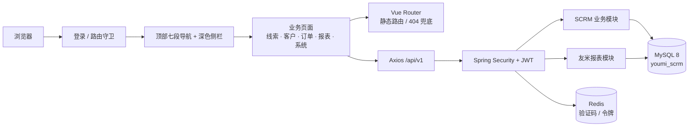

<div align="center">

# 友米 SCRM · 学习型复刻版

**一次独立完成的全栈界面与业务复刻练习**

七段式顶部导航 · 深色业务侧栏 · 员工绩效 · 线索/客户/订单 · Vue 3 + Spring Boot

[](https://vuejs.org/)
[](https://element-plus.org/)
[](https://spring.io/projects/spring-boot)
[](https://www.mysql.com/)
[](LICENSE)

</div>

> [!WARNING]
> **非官方项目，仅供学习与技术交流。**
>
> 本项目不隶属于「友米 SCRM」或其运营方，也不代表任何官方立场。项目中的产品名称、界面布局和交互方式仅用于说明复刻对象；代码为独立实现，**不包含源站代码、接口定义、静态资源、客户数据或后台业务逻辑**。演示数据全部为虚构内容。详见 [DISCLAIMER.md](DISCLAIMER.md)。

## 项目简介

这是一个可独立运行的全栈 SCRM 复刻练习。项目以一套 SaaS 型 SCRM 的信息架构和视觉语言为参照，使用 Vue 3 + Element Plus 重做前端，使用 Spring Boot 重做后端，并复用一套开源 CRM 数据模型完成线索、客户、订单和业绩报表的闭环。

它适合用来研究：

- 多层级顶部导航 + 上下文侧栏的复杂后台布局；
- 列表页、详情抽屉、审核流和统计报表的组件组织；
- 如何把一套通用「客户/商机/合同」模型映射成另一套产品语言；
- 在前端实现客户端的筛选、聚合、图表和 CSV 导出；
- 如何在不依赖源站接口的情况下，用独立后端支撑界面复刻。

### 这个项目是什么

- 一个可启动、可登录、可操作的全栈演示系统。
- 对参考产品**信息架构与视觉层**的独立重写。
- 一个可继续扩展的 Vue 3 + Spring Boot 工程模板。

### 这个项目不是什么

- 不是官方产品，不是官方源码，也不提供官方功能承诺。
- 不是完整功能对等复刻：大量导航入口被保留为占位页或权限提示。
- 不是可直接商用的生产系统；没有经过安全审计、压力测试和完整测试覆盖。

## 功能范围

### 已实现页面

| 页面 | 路由 | 说明 |
| --- | --- | --- |
| 登录 | `/login` | 品牌化登录页、算术验证码、JWT 登录 |
| 员工业绩 | `/report/performance` | 日期范围、部门/员工筛选、5 项统计卡、成交金额 ECharts 排行、员工明细、CSV 导出 |
| 员工绩效 | `/report/meritsrecord` | 签收绩效 / 线索转化绩效双标签、部门筛选、派生指标、CSV 导出 |
| 创建线索 | `/crm/clues/create` | 打开新建线索表单 |
| 待办线索 | `/crm/clues/todo` | 仅展示待跟进线索 |
| 管理线索 | `/crm/clues/manage` | 线索列表、筛选、编辑、详情、转客户、删除 |
| 公海线索 | `/crm/clues/pool` | 公海列表与领取 |
| 原始进线 | `/crm/clues/original` | 复用线索列表视图 |
| 管理客户 | `/crm/customer/list` | 客户列表、筛选、新建、编辑、详情、跟进、删除；含黑名单标签占位视图 |
| 订单列表 | `/crm/order/list` | 新建/编辑/删除、筛选、详情、CSV 导出 |
| 待审核 | `/crm/order/audit` | 审核视图、通过/驳回、批量审核 |
| 组织架构 | `/crm/system/dept` | 部门树、员工列表、通过部门过滤、员工导出 |
| 角色 | `/crm/system/role` | 角色 CRUD、分页与关键字筛选 |
| 云店管理 | `/gateway/store` | 平台卡片、授权说明、云店列表空状态 |

### 导航占位

七段顶部导航中的其余入口均已配置路由与页面骨架，包含：

- 线索管理：加粉管理、放弃线索复核、线索属性、转化流程、策略设置、公海设置
- 客户管理：客户属性、客户触达
- 订单管理：订单导入、我的任务、打单发货、仓库打单、跟单任务、待入仓、记账对账、售后单管理、已取消、供应商、订单属性、打单发货设置、云店管理、商品管理、仓库管理
- 系统设置：设备账号、员工组、功能模块、工作时间、页面设置、模板配置、系统日志、开放平台
- 统计报表：进粉分析、工作量报表、线索报表、流程报表、通话报表、渠道分析、其他订单报表、库存报表、后台下载
- 数据互通：云仓管理、商品管理、平台线索
- 质检管理：质检概览、质检任务、质检规则、会话质检

占位页会展示统一说明：当前账号暂无查看权限，或该模块尚未配置。这样做保留了参考产品的完整导航形态，同时避免用假交互冒充已实现功能。

## 技术栈

| 层次 | 技术 |
| --- | --- |
| 前端 | Vue 3.5、TypeScript、Vite 8、Element Plus 2.14、Pinia、Vue Router、ECharts 6 |
| 后端 | Java 17+、Spring Boot 4.0.1、Spring Security、JWT、MyBatis-Plus、Druid |
| 数据 | MySQL 8.0、Redis 7 |
| 接口文档 | SpringDoc / Knife4j |
| 工程化 | pnpm、Maven、ESLint、Prettier、Stylelint |

前端导航和路由完全静态定义，登录态由自定义路由守卫维护；后端沿用通用 SCRM 的认证、RBAC 与业务模块，并新增员工业绩聚合接口。

## 系统架构



详细设计见 [docs/architecture.md](docs/architecture.md)，视觉与交互决策见 [docs/design-notes.md](docs/design-notes.md)。

## 快速开始

### 环境要求

| 依赖 | 版本 |
| --- | --- |
| JDK | 17 或更高 |
| Maven | 3.9+ |
| Node.js | `^20.19.0` 或 `>=22.12.0` |
| pnpm | 8+ |
| Docker | 可选，用于 MySQL 与 Redis |

### 端口规划

复刻版刻意使用独立端口，便于与通用 SCRM 同时运行：

| 服务 | 地址 |
| --- | --- |
| 前端 | <http://localhost:3001> |
| 后端 | <http://localhost:8001> |
| MySQL | `localhost:3308` |
| Redis | `localhost:6380` |

### 1. 配置环境变量

```bash
cp .env.example .env
```

编辑 `.env`，至少修改：

```dotenv
MYSQL_ROOT_PASSWORD=你的数据库密码
REDIS_PASSWORD=你的Redis密码
JWT_SECRET=至少32位的随机字符串
```

`DB_PASSWORD` 必须与 `MYSQL_ROOT_PASSWORD` 保持一致。当前终端导入变量：

```bash
set -a && . ./.env && set +a
```

### 2. 启动 MySQL 与 Redis

```bash
docker compose up -d
```

首次启动会自动导入 [sql/youmi_scrm.sql](sql/youmi_scrm.sql)，其中包含系统表、SCRM 业务表、演示账号和虚构业务数据。

### 3. 启动后端

```bash
cd backend
mvn spring-boot:run
```

- API：<http://localhost:8001>
- Knife4j：<http://localhost:8001/doc.html>

### 4. 启动前端

另开终端：

```bash
cd frontend
pnpm install
pnpm dev
```

打开 <http://localhost:3001>。登录后默认进入 `/report/performance`；参考地址 `/report/performance/statistics` 也通过路由别名保留：

```text
http://localhost:3001/#/report/performance/statistics
```

### 默认账号

| 账号 | 密码 | 角色 |
| --- | --- | --- |
| `admin` | `123456` | 系统管理员 |
| `dept_member` | `123456` | 部门成员 |

> 请仅在本地演示使用。若部署到公网或团队环境，立即修改密码、JWT 密钥，并删除不需要的演示账号。

## 业务映射

复刻版沿用通用 SCRM 的客户与合同模型，通过状态和字段映射出参考产品的业务语言：

| 展示概念 | 数据来源 | 映射规则 |
| --- | --- | --- |
| 线索 | `biz_customer` | `status = 1` |
| 客户 | `biz_customer` | `status IN (2, 3)` |
| 客户转化 | `biz_customer.status` | 线索编辑为 `2` 后进入客户列表 |
| 订单 | `biz_contract` | 合同作为订单展示 |
| 待审核订单 | `biz_contract` | `status = 1` |
| 订单状态 | `biz_contract.status` | `1 待审核 / 2 已确认 / 3 已完成 / 4 已取消` |
| 员工业绩 | 聚合查询 | 按用户统计客户、跟进、订单、金额和赢单率 |
| 客户编码 | `biz_customer.id` | 前端格式化为 `Cxxxxxx` |

需要注意：此映射是为了在独立系统中还原界面语义，并不代表参考产品的真实数据模型。

## 目录结构

```text
youmi-scrm/
├── backend/                              # Spring Boot 后端
│   └── src/main/java/com/youlai/boot/
│       ├── module/scrm/                  # 客户、跟进、商机、合同
│       ├── module/youmi/                 # 复刻版新增：员工业绩报表
│       ├── auth/                         # 登录与验证码
│       ├── security/                     # JWT 与权限
│       └── system/                       # 用户、角色、部门、菜单
├── frontend/                             # Vue 3 前端
│   └── src/
│       ├── layouts/index.vue             # 顶部导航 + 上下文侧栏
│       ├── router/                       # 静态路由与守卫
│       ├── styles/youmi.scss             # 复刻版视觉令牌
│       ├── youmi/                        # 导航、常量、格式化
│       ├── api/youmi/                    # 报表与组织 API
│       └── views/youmi/                  # 复刻版页面
│           ├── lead/
│           ├── customer/
│           ├── order/
│           ├── report/
│           ├── system/
│           └── gateway/
├── sql/youmi_scrm.sql                    # 完整数据库初始化脚本
├── docs/                                 # 设计、接口、部署文档
├── docker-compose.yml
├── .env.example
├── DISCLAIMER.md
└── README.md
```

## 主要 API

除了复用通用 SCRM 接口，本项目新增：

```http
GET /api/v1/youmi/reports/performance?startDate=2026-10-14&endDate=2026-10-20
Authorization: Bearer <accessToken>
```

响应中的每个员工包含：

| 字段 | 说明 |
| --- | --- |
| `userId` / `userName` / `deptName` | 员工与部门 |
| `customerCount` | 名下客户总数 |
| `followCount` | 统计区间内跟进次数 |
| `orderCount` | 统计区间内新建订单数 |
| `orderAmount` | 统计区间内订单金额 |
| `winRate` | 已完成订单数 / 区间订单数 |

其余线索、客户、订单、角色、部门、用户接口与通用 SCRM 一致，详见 [docs/api.md](docs/api.md)。

## 测试与验证

本次交付前已完成：

- `vue-tsc --noEmit` 与 Vite 生产构建通过；
- Maven 打包通过，后端可在 8001 启动；
- 登录、员工业绩、员工绩效、线索列表、客户列表、订单列表、待审核、组织架构、角色、云店管理和占位页的页面联调；
- 员工业绩接口返回员工聚合数据，ECharts 图表与 CSV 导出可用；
- 通用 SCRM 与复刻版在独立端口、独立数据库和 Redis 库中同时运行。

当前没有引入端到端自动化测试；数据隔离、并发和权限回归仍需要补充。

## 已知限制

- 大量参考产品入口仅完成导航和占位，未实现真实业务逻辑。
- 未接入企业微信、开放平台、云店、短信、邮件或第三方质检服务。
- 业绩页的部门/员工筛选在前端完成；后端只按日期区间查询。
- 员工业绩中的「新增客户」当前统计员工名下客户总数，并非日期区间新增。
- 签收质量、日跟进量、转化评级是演示用派生指标，不代表参考产品的真实算法。
- 数据表使用演示数据；没有多租户、审批流、消息通知等生产能力。
- 上游模板中的代码生成、工作流等模块仅作为底座保留，未在复刻导航中启用。

## 文档

- [架构设计](docs/architecture.md)
- [API 说明](docs/api.md)
- [视觉与复刻笔记](docs/design-notes.md)
- [部署指南](docs/deployment.md)
- [免责声明](DISCLAIMER.md)
- [安全策略](SECURITY.md)
- [贡献指南](CONTRIBUTING.md)
- [第三方声明](THIRD_PARTY_NOTICES.md)

## 免责声明摘要

本项目用于学习 Web 应用架构、界面实现和全栈联调，不与参考产品的运营方存在隶属、合作或授权关系。项目不附带任何源站数据、代码或素材。若相关权利方认为本项目名称或展示方式不妥，可通过仓库 Issue 联系，维护者会及时调整或下线。完整条款见 [DISCLAIMER.md](DISCLAIMER.md)。

## 许可证与致谢

本项目原创部分以 [Apache License 2.0](LICENSE) 发布。系统底座来自以下开源项目：

- [vue3-element-admin](https://github.com/youlaitech/vue3-element-admin)（MIT）
- [youlai-boot](https://github.com/haoxianrui/youlai-boot)（Apache-2.0）
- [vue-element-admin](https://github.com/PanJiaChen/vue-element-admin)（MIT）

详细归属与许可证文本见 [THIRD_PARTY_NOTICES.md](THIRD_PARTY_NOTICES.md)、`frontend/LICENSE` 与 `backend/LICENSE`。
