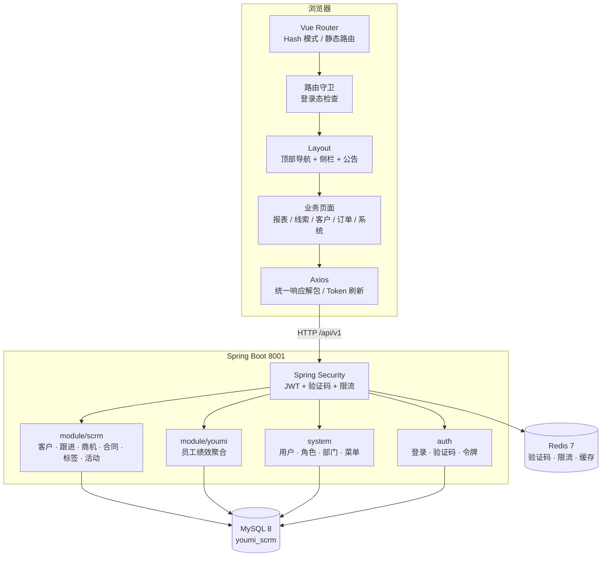
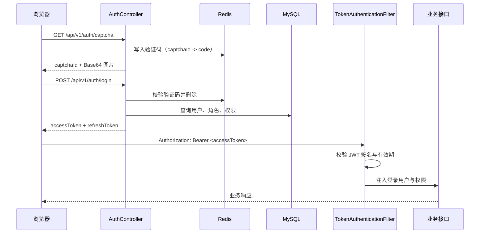
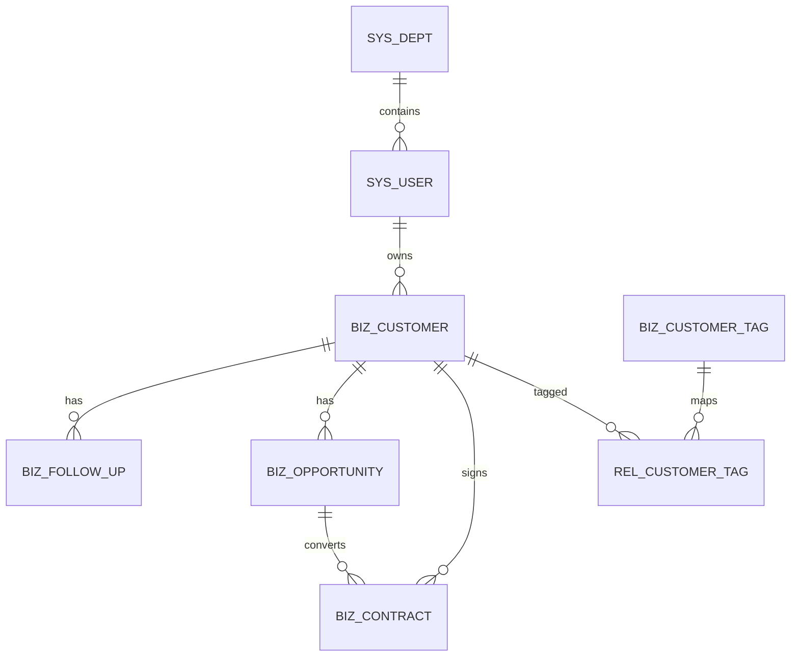

# 架构设计

本文说明友米 SCRM 复刻版的整体结构、模块边界和关键实现决策。阅读前建议先看 [README](../README.md) 了解项目定位：这是一个独立实现的全栈复刻练习，不包含参考产品的源码、接口或素材。

## 1. 设计目标与约束

| 目标 | 落地方式 |
| --- | --- |
| 可独立启动、可登录、可操作 | 自带数据库初始化脚本与 Docker Compose，前后端分离运行 |
| 与通用 SCRM 同时运行 | 前端 3001、后端 8001、MySQL 3308、Redis 6380 |
| 还原参考产品的信息架构 | 顶部七段导航 + 当前模块侧栏 + 内容区 |
| 不依赖源站 | 全部接口由本项目后端提供，演示数据为虚构数据 |
| 不照搬素材 | 图形使用 Element Plus 图标与 CSS 绘制，字体使用系统字体 |
| 可继续扩展 | 保留通用 SCRM 的认证、RBAC、用户/角色/部门与业务模块 |

主要约束：

- 前端是纯静态 SPA，生产环境不依赖 Node 服务。
- 后端无状态认证（JWT），不依赖 HTTP Session。
- 数据库结构以通用 SCRM 的客户/合同模型为基础，通过字段映射表达复刻产品的业务语言。
- 复刻范围聚焦「布局 + 报表 + 线索/客户/订单 + 基础系统管理」，其余导航保留占位。

## 2. 总体架构



开发环境请求链路：

```text
浏览器 -> http://localhost:3001
       -> /dev-api/**（Vite 代理，去掉前缀）
       -> http://localhost:8001/**
```

生产环境请求链路：

```text
浏览器 -> https://<域名>/prod-api/**
       -> Nginx 反代并去掉 /prod-api 前缀
       -> http://127.0.0.1:8001/**
```

前端 API 前缀分别由 `frontend/.env.development` 与 `frontend/.env.production` 中的 `VITE_API_BASE` 控制。

## 3. 后端结构

### 3.1 分层

```text
controller  -> 接收请求、参数校验、权限注解
service     -> 业务规则、事务、数据范围
mapper      -> MyBatis-Plus Mapper / 自定义 SQL
model       -> entity / form / query / vo
support     -> 数据范围等横切辅助
```

统一返回 `Result<T>`：

```json
{ "code": "00000", "data": {}, "msg": "操作成功" }
```

分页返回 `PageResult<T>`，`data` 为 `{ "list": [], "total": 0 }`。

### 3.2 模块职责

| 模块 | 包路径 | 职责 |
| --- | --- | --- |
| 认证 | `com.youlai.boot.auth` | 图形验证码、账号密码登录、短信登录、令牌刷新与退出 |
| 安全 | `com.youlai.boot.security` | JWT 解析、登录用户、权限判断、未认证/无权限处理 |
| 系统 | `com.youlai.boot.system` | 用户、角色、部门、菜单、字典、通知、日志 |
| SCRM | `com.youlai.boot.module.scrm` | 客户、跟进、商机、合同、标签、营销活动、工作台 |
| 友米报表 | `com.youlai.boot.module.youmi` | 员工绩效聚合查询，复刻版新增 |
| 基础设施 | `com.youlai.boot.common` / `core` / `config` / `support` | 响应体、异常、注解、Redis、邮件、文件、WebSocket |

`module/youmi` 刻意保持很小：只包含一个控制器和一个 VO。它直接使用 `JdbcTemplate` 做聚合查询，避免为一张报表引入新的实体和 Mapper。这是演示项目的取舍，不代表大型系统的推荐做法。

### 3.3 认证与权限



- 默认会话方式为 `jwt`，访问令牌 2 小时、刷新令牌 7 天，可由环境变量覆盖。
- 登录接口要求 JSON 请求体，并携带 `captchaId` 与 `captchaCode`。
- 后端使用 `@PreAuthorize("@ss.hasPerm('...')")` 做接口级权限校验；前端导航是静态的，因此「页面能打开」不等于「接口有权限」。
- `ScrmDataScope` 提供简单数据范围：`ADMIN`、`DEPT_MANAGER` 与超级管理员可查看全部，其他账号只看自己名下的数据。

### 3.4 报表聚合

`GET /api/v1/youmi/reports/performance` 使用一条 SQL 完成聚合：

```text
sys_user (在职、未删除)
  LEFT JOIN sys_dept
  ├─ 客户数：biz_customer.owner_id = 用户，统计全部（不限日期）
  ├─ 跟进数：biz_follow_up.create_by = 用户，限定创建时间区间
  ├─ 订单数：biz_contract.owner_id = 用户，限定创建时间区间
  ├─ 订单金额：同一区间内合同金额求和
  └─ 赢单率：区间内 status = 3 的合同数 / 区间订单数
```

相关实现见 `backend/src/main/java/com/youlai/boot/module/youmi/controller/YoumiReportController.java`。

统计口径的两个注意点：

1. `customerCount` 统计的是该员工名下全部客户记录，**不是**日期区间内新增的客户数。
2. 赢单率的分母是区间内新建订单数，而不是区间内完成订单数；跨期成交的订单不会进入历史区间的分母。

这些口径与界面文案一致，但不等同于真实产品的财务口径。

## 4. 前端结构

```text
frontend/src/
├── layouts/index.vue        # 顶部七段导航 + 上下文侧栏 + 公告 + 用户菜单
├── router/
│   ├── index.ts             # 静态路由、别名、占位路由、404
│   └── guards.ts            # 登录态与页面标题
├── styles/youmi.scss        # 主色、卡片、筛选栏等视觉令牌
├── youmi/
│   ├── menu.ts              # 导航结构（顶部区块 + 侧栏条目）
│   └── constants.ts         # 状态、来源、级别标签与格式化函数
├── api/youmi/index.ts       # 绩效、部门、用户、角色接口
└── views/youmi/
    ├── lead/LeadList.vue           # 线索多视图（待办/管理/公海/原始进线）
    ├── customer/CustomerList.vue   # 客户列表与黑名单占位视图
    ├── order/OrderList.vue         # 订单列表与待审核视图
    ├── report/PerformancePage.vue  # 员工业绩
    ├── report/MeritsPage.vue       # 员工绩效
    ├── system/DeptPage.vue         # 组织架构
    ├── system/RolePage.vue         # 角色
    ├── gateway/StorePage.vue       # 云店管理
    └── PlaceholderPage.vue         # 未实现导航的统一占位
```

### 4.1 路由模型

- 使用 `createWebHashHistory()`，静态托管无需服务端 rewrite。
- 所有业务路由在 `constantRoutes` 中静态声明，不依赖后端菜单下发。
- `/` 重定向到 `/report/performance`。
- `/report/performance/statistics` 是 `/report/performance` 的别名，用于兼容参考产品的地址形态。
- 未匹配路由重定向到 `/404`。

### 4.2 导航模型

顶部七个区块：线索管理、客户管理、订单管理、系统设置、统计报表、数据互通、质检管理。

每个区块包含 `path`（点击区块时跳转）和 `items`（侧栏条目）。侧栏根据当前路径定位区块，条目激活规则支持子路径；`/crm/clues/create` 被视为一次性入口，不作为其他线索页的父级高亮。

导航数据集中在 `frontend/src/youmi/menu.ts`。新增页面时需要同时：

1. 在 `menu.ts` 增加条目；
2. 在 `router/index.ts` 增加路由；
3. 若为占位页，复用 `PlaceholderPage`。

### 4.3 数据访问

- Axios 实例自动附加 `Authorization`，并按业务码解包 `data`。
- 业务失败统一 `ElMessage` 提示并 reject，页面只需处理成功分支。
- 401/令牌失效由续期拦截器处理，续期失败后清理状态并回到登录页。
- 后端将 `Long` 序列化为字符串，凡参与运算的 ID 或金额先 `Number(...)`。

### 4.4 页面模式

大多数业务页遵循同一结构：

```text
标题
筛选卡片（关键词 / 状态 / 日期 / 部门 / 员工 ...）
操作栏（新建、导出、批量操作）
表格 + 分页
表单对话框 / 详情抽屉
```

报表页在筛选区下方增加统计卡与图表；CSV 导出在前端生成 Blob，不经过后端。

## 5. 数据模型



`biz_campaign` 暂无外键关联到客户，营销活动的 `lead_count` 是独立统计字段。

### 5.1 业务表

| 表 | 说明 | 关键字段 |
| --- | --- | --- |
| `biz_customer` | 线索与客户共用一张表 | `status`、`level`、`source`、`owner_id`、`dept_id`、`is_deleted` |
| `biz_follow_up` | 跟进记录 | `customer_id`、`type`、`content`、`result`、`next_follow_time` |
| `biz_opportunity` | 商机 | `customer_id`、`stage`、`probability`、`amount`、`expected_close_date` |
| `biz_contract` | 合同（复刻版作为订单展示） | `contract_no`、`customer_id`、`amount`、`status`、`sign_date` |
| `biz_customer_tag` | 标签定义 | `name`、`color`、`sort` |
| `rel_customer_tag` | 客户与标签关联 | `customer_id`、`tag_id` |
| `biz_campaign` | 营销活动 | `type`、`channel`、`budget`、`status`、`lead_count` |

### 5.2 状态约定

客户状态：

| 值 | 含义 | 复刻版用途 |
| --- | --- | --- |
| 1 | 潜在客户 | 线索 |
| 2 | 跟进中 | 客户 |
| 3 | 已成交 | 客户 |
| 4 | 已流失 | 客户（历史状态） |

订单（合同）状态：

| 值 | 含义 |
| --- | --- |
| 1 | 待审核 |
| 2 | 已确认 |
| 3 | 已完成 |
| 4 | 已取消 |

线索与客户列表通过 `statuses=1` 或 `statuses=2,3` 区分，后端把逗号分隔字符串解析为 `IN` 条件。

### 5.3 通用约定

- 所有业务表使用逻辑删除 `is_deleted`，MyBatis-Plus 自动追加条件。
- 审计字段为 `create_by`、`create_time`、`update_by`、`update_time`，由元对象处理器填充。
- 客户同时记录 `owner_id` 与 `dept_id`，便于按人/按部门过滤。
- 主键与金额在前端按字符串接收，展示与计算时转换。

## 6. 与通用 SCRM 的关系

| 维度 | 通用 SCRM | 复刻版 |
| --- | --- | --- |
| 目录 | `scrm/` | `youmi-scrm/` |
| 数据库 | `youlai_admin` | `youmi_scrm` |
| 前端/后端 | 3000 / 8000 | 3001 / 8001 |
| MySQL / Redis | 3307 / 6379 DB12 | 3308 / 6380 DB0 |
| 布局 | 后台管理式侧边菜单 | 顶部七段导航 + 上下文侧栏 |
| 报表 | 工作台聚合 | 员工业绩与员工绩效 |
| 业务重点 | 客户、跟进、商机、合同 | 线索/客户、订单、绩效 |

两套系统可以同时运行，但**不要共用同一个数据库或 Redis 库**：初始化脚本、菜单数据和业务种子数据不同，混用会出现菜单缺失或数据串台。

## 7. 已知边界

- 导航是静态的，占位页不响应真实权限配置。
- 未实现多租户、审批流、消息中心、企业微信、云店授权和第三方质检。
- 数据范围只区分「全部」与「本人」，没有按部门树递归。
- 业绩聚合未做缓存，数据量增大时需要索引或预聚合。
- 前端未引入端到端测试，关键流程依赖手工回归。

## 8. 可扩展方向

1. 把静态导航改为后端菜单 + 权限过滤，保持 URL 不变。
2. 为报表增加部门维度和日期区间新增客户数。
3. 为订单补齐审核记录、发货状态与售后单据。
4. 引入 Testcontainers + Playwright，覆盖登录、线索转化、订单审核和报表导出。
5. 将 `module/youmi` 的直连 SQL 改为独立 Mapper，便于分页和单元测试。
